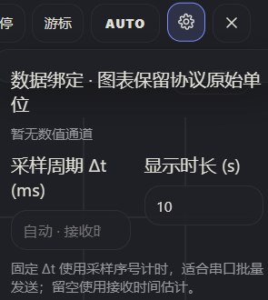

# SerialWeb 网页串口调试与图形解析工具

本分支已适配 **StandardRobot++ 上位机协议**：默认主页面显示 IMU 姿态、欧拉角和角速度，自定义调试包自动生成可选绘图通道，同时保留设备连接管理与通用串口功能。连接后选择「StandardRobot++ 协议」即可使用，详见 [协议格式、操作说明与验证方法](docs/standardrobot-protocol.md)。

StandardRobot++ 模式下，机器人运行数据在 IMU 下方分组显示；绘图来源只提供自定义调试数据，通道列表直接使用设备发送的字段名称。

波形绘图已增加尖峰保留、Δt 采样周期、暂停/跟随、通道图例开关、双游标及 FFT 窗函数/去直流设置，详见 [时域与频域说明及预览](docs/waveform.md)。

**网页串口工作台**：通过 Web Serial API 连接串口设备，支持在线访问与离线本地使用；涵盖设备连接管理、实时监视、文本/HEX 解析、时域/频域/柱状图绘制、手动/定时/触发/预设发送，以及时间线录制、回放与导出；并嵌入可供 AI 直接读取的开发 skill，可用于开发同类型应用，或以其为基座构建应用型程序。

**打开就能用，不需要安装。**

| 使用方式 | 入口 | 说明 |
| --- | --- | --- |
| **在线版（HTTPS）** | <https://zici233.github.io/Polarbear_SerialWeb/> | 当前分支的 GitHub Pages 网站 |
| **离线版** | 页面右上角菜单 → **下载离线版到本地** | 得到一个 HTML 文件，双击即可打开，无需联网 |

- 串口数据**全程在你的浏览器本地处理**；当前版本为纯静态网站，不依赖服务端 API。
- 需要 **Chromium 内核浏览器**（Chrome / Edge 等），并运行在 `HTTPS` 或 `localhost` 下。

---

## 网站部署

- 源码仓库：<https://github.com/zici233/Polarbear_SerialWeb>
- 在线地址：<https://zici233.github.io/Polarbear_SerialWeb/>
- 发布方式：GitHub Pages，发布分支为 `main`，目录为 `/ (root)`。
- 根目录的 `.nojekyll` 用于直接发布静态文件，无需安装依赖或构建。
- 后续将修改提交到 `main` 后自动更新网站，可在仓库 Actions 页面查看部署结果。
- 浏览器需要支持 Web Serial；访问在线版后点击连接按钮，授权访问当前电脑的串口设备。

## 快速上手（3 步）

1. **连接**：打开页面 → 左侧「设备连接管理」→ 点击「连接设备」，在浏览器弹出的窗口里选择你的串口
2. **确认数据**：设置波特率 / 数据位 / 停止位 / 校验位 → 切到「**监视**」，确认设备正在输出数据
3. **留存实验**：点击顶部 **REC** 开始录制时间线 → 切到「**解析**」建立解析规则、添加图形

> **最值得记住的一条：先录制时间线，再做解析。**
> 解析规则可以反复修改、重新套用；而原始数据只会出现一次。

---

## 功能一览

| 模块 | 能做什么 |
| --- | --- |
| **设备连接管理** | 串口连接 / 断开、自动重连、波特率预设、数据位 / 停止位 / 校验位、硬件流控、DTR / RTS / BREAK 控制、CTS / DSR / DCD / RI 状态、失焦自动断连 |
| **实时监视** | 原始收发内容展示、按 `\r\n` / `\r` / `\n` 自动分帧、TX / RX / FPS 统计、显示缓存控制 |
| **发送** | **立即发送**（手动）、**定时发送**（周期轮询）、**触发发送**（收到什么回什么）、**预设发送**（常用指令一键调用） |
| **文本解析** | 模板提取字段（如 `A=12,B=3.14`、`temp-1=25.4`、`adc.ch0=1024`），支持自动识别稳定结构并一键应用 |
| **十六进制解析** | 按「帧头 / 数据 / 校验 / 帧尾 / 间隔符」定义二进制帧结构，支持 `uint8`~`uint32`、`float16/32`、`bool8` 及大小端 |
| **图形分析** | 时域图、频域图、柱状图；可自由增删图框、调整顺序、绑定字段、设置量程 |
| **时间线** | 录制 / 回放 / 冻结锁定 / 导入导出（`BIN` `TXT` `CSV`），回放时重新生成监视器内容、解析结果与图形 |
| **导出** | 原始时间线（`BIN` / `TXT` / `CSV`）与解析结果（`TXT` / `CSV`，带 UTF-8 BOM，Excel 可直接打开） |
| **主题与布局** | 跟随系统或手动切换浅色 / 深色；宽屏与窄屏自动适配 |

---


```


---

## 详细说明

### 1. 设备连接管理

系统的配置中枢。宽屏下以左侧面板展开 / 折叠；窄屏下以浮层打开，内容与逻辑完全一致。

这里设置的项都会影响后续的**录制、解析和回放**行为，建议在实验开始前先确认：

- 串口连接与断开、自动重连、失焦自动断连
- 波特率与预设值、数据位、停止位、校验位
- 硬件流控、DTR / RTS / BREAK、CTS / DSR / DCD / RI
- **字符编码**：`UTF-8`（默认）/ `ASCII` / `Latin-1` / `UTF-16LE`
- **换行符设置**、结尾补换行符
- 十六进制显示 / 发送、时间戳显示方式

### 2. 监视模式

用于回答「设备到底发了什么、系统到底收到了什么」。

- **自动分显示帧**：遇到 `\r\n` / `\r` / `\n` 结束一行（三者都只算**一次**换行）；设备持续发送且不换行时，数据会接续到当前这一条，直到出现换行符、你触发一次发送，或单条累计超过 2048 字节 / 字符被强制断开
- **顶部状态**：模式状态、TX / RX 统计、FPS；回放模式下这些统计会按回放位置重新计算
- **显示缓存控制**：只保留最近一段有效数据，长时间运行也不会越用越慢

### 3. 发送功能

| 方式 | 适用场景 |
| --- | --- |
| 立即发送 | 手工输入后立刻发送，遵循当前编码 / 换行 / HEX 设置 |
| 定时发送 | 周期轮询、心跳包、采样触发；维护发送队列按固定间隔循环发送 |
| 触发发送 | 简单握手、自动应答；定义「收到什么后自动回复什么」 |
| 预设发送 | 把高频命令整理为固定条目，可附预期响应，用于稳定重复验证 |

### 4. 解析模式

把原始数据转换为**成功解析帧**，再变成结构化结果与图形。

- **文本解析**：模板宽松匹配，`_`、`-`、`.` 都可作为字段名的一部分；支持自动识别稳定结构并提示一键应用模板
- **十六进制解析**：默认结构为 `帧头 A5` + 数据 + `校验 SUM8` + `帧尾 5A`，可自定义帧头 / 帧尾 / 间隔符 / 校验方式
- **实时结果卡片**：每成功识别一帧即进入统一的成功帧序列，最新值以卡片形式展示，便于确认字段是否提取正确

### 5. 时间线系统

不是「顺手录个日志」，而是一套围绕原始数据的记录 / 回放 / 导出体系。

- **记录内容**：带时间信息的**原始串口数据**，因此可以重新用于重建监视器显示、重新套用解析模板与结构表、重新生成时域图与频域图
- **回放**：切换到任意时间线后，系统会重新走一遍数据解释过程，而不是播放一张静态快照
- **冻结**：实时模式下可临时冻结（鼠标悬浮暂停按钮）或锁定冻结（点击），只影响显示层，**后台仍继续接收**
- **导入导出**：`BIN` / `TXT` / `CSV`；录制得到的时间线也可直接导出为 `TXT` / `CSV` 继续处理

### 6. 导出与数据格式

| 导出内容 | 格式 | 用途 |
| --- | --- | --- |
| 原始时间线 | `BIN` / `TXT` / `CSV` | 保存实验现场、分享测试过程、原始数据归档 |
| 解析结果 | `TXT` / `CSV` | 已按模板 / 结构表解释后的字段数据，直接交给 Excel、Python、MATLAB、Origin |

> 导出 `CSV` 时写入 **UTF-8 BOM**，Excel 双击打开不会中文乱码（v2.0 起）。

### 7. 配置复用

菜单中的「**复制配置** / **粘贴导入** / **清空配置**」可以整体搬运：

- 串口参数、发送配置、解析模板、图框结构与图形设置

适合团队统一协议模板、保存成熟实验配置、换机或换人时快速复现同一套实验环境。

---

## 运行环境要求

| 项目 | 要求 |
| --- | --- |
| 浏览器 | Chromium 内核：Chrome、Edge 等（**不支持** Firefox、Safari —— 它们没有 Web Serial API） |
| 访问方式 | `HTTPS` 或 `localhost`（Web Serial API 的安全上下文要求）；离线版以 `file://` 打开同样可用 |
| 操作系统 | Windows / macOS / Linux 均可；驱动按设备厂商要求安装 |
| 其他 | 打开串口前，请先关闭其它占用该串口的软件（串口助手、IDE 串口终端等） |

---

## 给 AI 与开发者

### 应用本体就是单文件

`index.html` 一个文件即完整应用（HTML + 内联 CSS + 单个 IIFE 脚本），**无任何外部 CSS / JS / 图片依赖**，可以随意复制到任何静态托管平台。

### 内嵌给 AI 的提示词

页面 `<head>` 里内嵌了一段 Agent 提示词，三种读法任选：

1. 在源码中搜索标记 **`SERIALWEB-AGENT-PROMPT`**
2. 读取 `<body>` 末尾的隐藏文本节点 `<div id="ai-agent-prompt">`（对用户不可见、不可选中，但源码、DOM 与「整页可见文本提取」都能读到）
3. 运行时执行 `document.getElementById('ai-agent-prompt').textContent`

### 开发指南（供 AI / 开发者直接使用）

《用 HTML + Web Serial 构建串口上位机应用》—— 连接与自动重连、发送、接收分帧、编码、解析、绘图、录制回放、配套下位机协议与硬件设计，含可直接复制的可运行骨架与坑清单：

- 本地：`skills/html-webserial-app/SKILL.md`
- GitHub：<https://raw.githubusercontent.com/Conductance-lab/SerialWeb/main/skills/html-webserial-app/SKILL.md>
- 国内站点：<https://conductance-lab.xyz/SerialWeb/skills/html-webserial-app/SKILL.md>

### 其它 AI 读取入口

| 入口 | 位置 | 说明 |
| --- | --- | --- |
| `llms.txt` | 站点根 | 供只抓纯文本的 AI 使用的索引 |
| `AGENTS.md` | 仓库根 | 仓库级 AI 约定与结构说明 |
| `ai/agent-prompt.md` | 仓库 | 内嵌提示词的**唯一来源** |

### 修改 index.html 的注意事项

- 用**精确字符串替换**编辑，不要用 shell 脚本 / 正则批量改写（会破坏编码、换行与模板字符串）
- 功能改动走集中的 `state` + `scheduleRefresh()` 刷新链路，不要零散直改 DOM
- 涉及收发 / 解码 / 编码的改动，务必在浏览器里用真实数据验证

### 项目结构

```
index.html                            # 应用本体（单文件）
release/vX.Y/                         # 历史版本快照（index.html + LICENSE + README.md）
skills/html-webserial-app/SKILL.md    # 面向 AI/开发者的实战开发指南
ai/agent-prompt.md                    # 内嵌提示词的唯一来源
tools/sync-agent-prompt.mjs           # 提示词注入 / 校验脚本
AGENTS.md                             # 仓库级 AI 入口约定
llms.txt                              # 站点根 AI 索引
LICENSE                               # AGPL-3.0
README.md                             # 本文件
```

---

## 开源协议与版权

**开源协议：AGPL-3.0**（GNU Affero General Public License v3.0）
你可以自由使用、修改、分发；但**如果修改后通过网络向他人提供服务，必须公开你的完整源码**。分发时请附带本仓库的 `LICENSE`。

本工程基于**电导实验室（Conductance-lab）**开发的 SerialWeb 修改，B 站账号 **电导不是韩导**，官网 <https://conductance-lab.xyz/>。本分支增加了 StandardRobot++ 协议、IMU 与机器人状态分组展示，以及自定义调试数据绘图。

- 网页基座源码：[Conductance-lab / SerialWeb](https://github.com/Conductance-lab/SerialWeb)，采用 AGPL-3.0，许可证见 [LICENSE](LICENSE)。
- 协议参考源码：[zhc / StandardRobot++ 上位机](https://gitee.com/y19zhc/Serial_Port_Assistant)，采用 MIT。核对提交 `4cf8689b90e005ec2e7d0b728b8534e5af7de1d8` 的 `lib/serial_frame.py`、`lib/data_procecss.py`、`lib/data_typedef.py` 和 `lib/CRC8_CRC16.py`。版权声明见 [协议参考项目许可证](docs/Serial_Port_Assistant-LICENSE.txt)。

原作者署名、上游项目和源码链接统一在本 README 中声明，网页界面和其他操作说明不重复展示。

---

## 联系与反馈

| 渠道 | 地址 |
| --- | --- |
| 工具手册 | <https://docs.conductance-lab.xyz/%E5%B7%A5%E5%85%B7%E6%89%8B%E5%86%8C/SerialWeb%E5%B7%A5%E5%85%B7%E6%89%8B%E5%86%8C> |
| 问题反馈 | <https://docs.qq.com/form/page/DU1B2RWVyZnJERHdq> |
| 电导实验室官网 | <https://conductance-lab.xyz> |
| GitHub | <https://github.com/Conductance-lab/SerialWeb> |
| B 站主页 | <https://space.bilibili.com/501542342> |
| 联系邮箱 | <mailto:conductance-lab@foxmail.com> |

---


> 页面内也能随时查看：右上角菜单 → **关于 vX.Y**。
