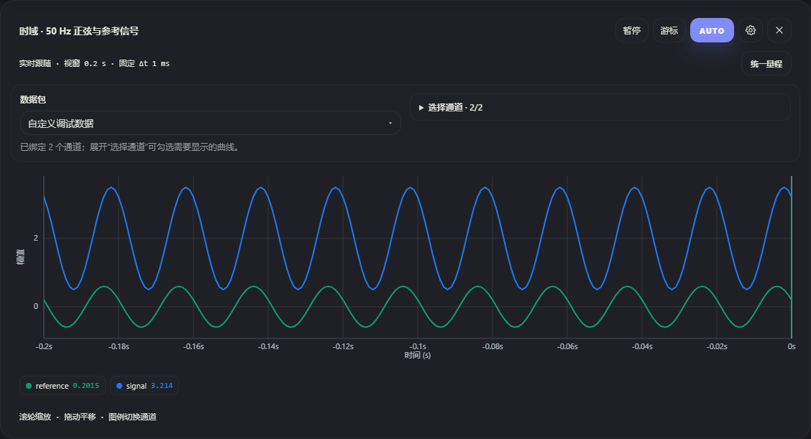
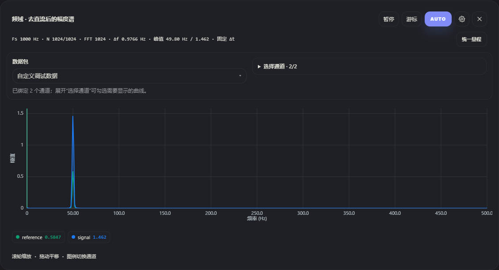

# 时域与频域绘图

本次改进参考 [VOFA+ 官方波形图文档](https://www.vofa.plus/docs/learning/widgets/wave/) 中的 Δt 设置、Auto、分轴缩放、通道选择和游标测量交互。网页继续使用单文件 Canvas 2D 绘图，无外部图表依赖，可离线运行。

## 图是什么

| 图形 | 横轴 | 纵轴 | 数据与处理 |
| --- | --- | --- | --- |
| 时域 | 相对最新点的时间，最新点为 0，左侧为历史时间 | 所选字段的协议原始数值 | 默认最近 10 秒，可设置为 0.01～60 秒；多通道折线 |
| 频域 | 频率 Hz，默认范围 0～Fs/2 | 单边幅度谱，保留输入数值单位 | 每通道最近 N 个采样；可选 Hann / 矩形窗，默认减均值去直流，FFT 后做窗增益及单边幅值校正 |
| 柱状图 | 所选通道 | 最新数值 | 每个通道的最新值，可单独暂停 |

下面的截图来自浏览器中的实际接收管线：分批发送 50 Hz 正弦及参考信号，图框设置 Δt=1 ms。时域显示 0.2 秒，频域使用 Hann 窗及 1024 点采样。





## 使用

- **选择数据与通道**：每个图框上方有独立的数据选择区，无需打开齿轮设置。StandardRobot++ 模式的来源固定为「自定义调试数据」，展开旁边的「选择通道」按设备发送的名称勾选单路字段，保留原始大小写与中文；IMU 和其他内置包在上方信息面板中单独显示。选择框标题显示已选/可用数量。尚未收到数据时会等待，后续收到的字段自动加入，已取消的勾选与展开状态会保留。图框下方图例与曲线使用相同颜色，点击图例也可隐藏/恢复单路通道，与选择框同步。通用文本/HEX 模式继续在同一独立选择框中勾选字段。齿轮设置只调整采样周期、显示时长和 FFT 等参数。
- **暂停 / 继续**：暂停只冻结当前图框的数据快照，串口接收和 REC 录制继续进行。点击继续恢复实时跟随。切换协议、时间线或清空数据时会清除旧快照和游标。
- **AUTO**：恢复自动量程及跟随最新数据；暂停中的图框仍使用其冻结数据。
- **缩放**：绘图区滚轮缩放 X/Y，坐标轴处滚轮单独缩放相应轴。横轴缩放以鼠标位置为锚点。绘图区拖动平移；横向移动后停留在历史位置，新数据不再把窗口推走。点击 AUTO 回到最新。
- **悬停读数**：移动到绘图区会出现十字线，图例显示各可见通道在该位置最近采样点的值。频域图例默认显示该通道频谱峰值幅度，鼠标停在图例上可查看峰值频率。
- **A/B 游标**：点击「游标」会暂停当前图框。依次点击绘图区放置 A、B，时域显示 Δt、ΔY、1/Δt，频域显示 Δf、ΔA。第三次点击开始新测量；两点使用同一可见通道。1/Δt 是所选时间差的倒数，选择一个完整周期时才对应该信号的频率。

## 采样周期 Δt

各时域/频域图框设置中都有「采样周期 Δt (ms)」。请填写**设备采样数据之间的真实周期**，不使用浏览器一次接收整批数据的间隔。

- 留空：时域使用接收时间；频域尝试从通道的正时间差中位数估计采样率，并注明是估计值。重复时间戳会提示批量接收；若所有采样都在同一接收时刻，频域提示填写 Δt。
- 填入正值：时域按各通道已接收样本序号重建等间隔时间轴，频域使用 `Fs=1000/Δt`。适合设备采样均匀、串口合并发送的数据。
- 每个图框独立设置，同一信号的时域/频域图应填写相同的 Δt。一个图框的固定 Δt 应适用于该图框的全部所选通道；不同采样率的信号可放在不同图框。
- 丢失的设备采样无法通过样本序号恢复。非均匀采样、串口延迟和批量发送会影响自动估计的频率准确度。

例如 Δt=1 ms 时，Fs=1000 Hz，最高可分析到 500 Hz；1024 点 FFT 的频点间隔约 0.9766 Hz。50 Hz 不恰好位于频点上，峰值可能显示为 49.80 Hz，幅值也会有栅栏效应误差。增大采样长度可以缩小频点间隔，插入更多零本身不会提高真实频率分辨能力。

## 频谱参数

- FFT 采样点数支持 16～32768 的 2 的幂。尚未收满设定点数时，用已有采样并补零到下一个 2 的幂，信息栏显示当前采样数、设定点数、实际 FFT 长度和频点间隔 Δf。
- Hann 窗适合日常观察；矩形窗适合整周期、相干采样的数据。默认「去直流」先减去采样均值，方便观察小振动；需要查看静态分量时取消勾选。
- 纵轴是单边幅值，不是功率谱密度、RMS 或 dB。普通正频率做双倍幅值校正，直流与 Nyquist 点不翻倍；窗增益单独归一化。
- 信息栏采样率和点数对应首个可见通道，峰值为可见通道中最大的频谱峰；每个通道自己的峰值可从图例查看。

## 绘制与性能

接收、解析和绘制分离，使用 `requestAnimationFrame` 合并刷新。曲线按设备像素比例绘制，并裁剪在坐标框内；自动量程留出上下余量。

时域先通过二分查找截取可见范围及邻点，密集曲线按像素桶保留首点、最小值、最大值和末点，避免仅取最后一点时漏掉窄尖峰。抽取只影响屏幕绘制，保留的原始采样值不被覆盖，游标查询使用采样数据。频域在 FFT 之后进行同样的绘图压缩，不用压缩后的折线做 FFT。

频谱缓存分别按通道保存；参数不变、采样窗口不变时不重复计算，避免多通道轮流覆盖同一个缓存。固定 Δt 的频谱只转换当前 FFT 窗口，不映射整个历史缓存。

## 验证

安装依赖及浏览器的方法见 [协议适配说明](standardrobot-protocol.md#浏览器验证)。

```powershell
node tools/test-waveform.cjs
node tools/test-robot-protocol.cjs
node tools/sync-agent-prompt.mjs --check
```

绘图测试使用内存中的临时插桩页，覆盖已知频率/幅度、窗函数、直流与 Nyquist 归一化、尖峰保留、FFT 缓存、真实协议管线的批量数据、暂停/继续、游标、缩放/跟随、手机端采样周期输入、参数保存、深色主题和不同屏宽。实际硬件采样率仍需按设备配置确认。

作者署名与项目出处统一见 [README](../README.md#开源协议与版权)。
